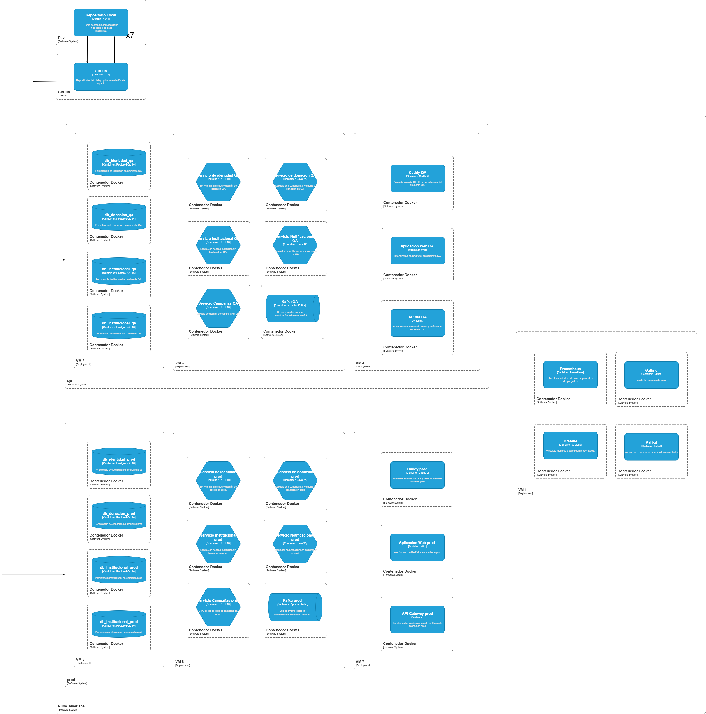

# Control de versiones
| Versión | Fecha | Descripción |
|---|---|---|
| 1.0 | 22/09/2026 | Diseño inicial de la solución, línea de diseño, servicios, C4 y relación con datos e integración. |
| 2.0 | 07/10/2026 | Alineación con Sprint 3: cinco microservicios, Caddy + APISIX, Kafka + Transactional Outbox, frontend React, vistas C4 actualizadas, despliegue en siete VMs y trazabilidad con DD V3 e Infraestructura V2. |
| 2.1 | 17/10/2026 | Corrección de consistencia entre SAD, SDD, DD, Infraestructura y TD: vistas C4 redibujadas como fuente Mermaid (APISIX en lugar de YARP; sin consulta HTTP Donación-Campañas, sustituida por una proyección local alimentada por eventos; Outbox visible en Donación y Campañas; Kafka y Kafbat en el despliegue; aplicación web única y actor Ciudadanía integrado en U1; SIHEVI-INS como sistema externo); responsabilidades de Identidad (RF-22), Donación (transferencias, escalamiento, proyección de campañas y proceso de vencimiento) e Institucional (consulta compuesta y analítica previstas); referencia a ADR-011 para la matriz de autorización; tecnologías previstas de los servicios pendientes; y nuevos pendientes (SIHEVI-INS, deduplicación de Notificaciones, numeración de ADR). |
| 2.2 | 02/11/2026 | Alineación con la integración del Sprint 4: Institucional implementado (hexagonal, .NET 10), Notificaciones implementado con el contacto en EV-02, comunicación entre servicios de negocio solo por Kafka (EV-07, EV-09, EV-10), validación del token en los servicios con la llave pública, creación y edición de campañas, base de Notificaciones en construcción, correspondencia diseño-implementación y pendientes actualizados. Se retiran los enlaces a fuentes `.mmd` que no existen en el repositorio. |
| 4.0 | 05/11/2026 | Versión de la entrega del Sprint 5 (se numera SDD V4 conforme a la entrega del curso): la integración del Sprint 4 queda en las ramas `develop`; la base `db_notifications` está desplegada y el trabajador se conecta a ella, aunque el flujo de entrega aún no la usa; referencias actualizadas a SAD V5.0, DD V5.0, Infraestructura V4.0 y TD V3.1. |

# 1. Propósito
El **Software Design Description (SDD) V4.0** describe cómo se materializan en el diseño de RedVital las decisiones definidas en el SAD V5.0.

El SDD documenta:

- la línea de diseño de la solución;

- la estructura del frontend;

- los servicios y sus responsabilidades;

- las vistas C4;

- la integración entre componentes;

- la relación con los datos;

- el despliegue desde la perspectiva de diseño;

- los contratos;

- la trazabilidad entre arquitectura, diseño e implementación.

El SDD no reemplaza el SAD, el DD ni el Documento de Infraestructura.

# 2. Alcance
El documento cubre:

1\. principios de diseño;

2\. diseño de interfaz;

3\. diseño de servicios;

4\. C4 Nivel 1 - Contexto;

5\. C4 Nivel 2 - Contenedores;

6\. C4 Nivel 3 - Componentes;

7\. vista de despliegue;

8\. diseño de integración;

9\. relación con datos;

10\. contratos;

11\. trazabilidad;

12\. estado de diseño e implementación.

# 3. Relación con otros artefactos
| Artefacto | Relación |
|---|---|
| SAD V5.0 | Define estructura, drivers, restricciones y decisiones arquitectónicas. |
| SRS V5.2 | Define usuarios, módulos, requisitos y flujos funcionales. |
| ADRs | Justifican decisiones de diseño estructural; ADR-011 define la matriz de autorización por grupo de operaciones. |
| DD V5.0 (Data Design Document) | Define propiedad de datos, modelo lógico/físico y diccionario. No contiene la matriz de autorización ni el catálogo de operaciones. |
| Infraestructura V4.0 | Define VMs, redes, puertos, contenedores y operación. |
| OpenAPI | Define contratos HTTP expuestos por la capa de aplicación. |
| AsyncAPI | Define eventos asíncronos. |
| Frontend | Materializa navegación, componentes visuales y flujos de usuario. |
| Testing | Valida el diseño implementado. |

En este conjunto documental «DD» significa Data Design Document. La matriz de autorización está en ADR-011, como la cita el SRS V5.2.

# 4. Principios de diseño
RedVital adopta los siguientes principios:

1\. separación de responsabilidades;

2\. servicios de grano grueso;

3\. contratos explícitos;

4\. persistencia propia por servicio;

5\. cero acceso cruzado a bases;

6\. cero llamadas HTTP directas entre microservicios de negocio;

7\. integración asíncrona mediante Kafka;

8\. autorización en gateway y validación en servicio;

9\. diseño de interfaz consistente y accesible;

10\. configuración externa;

11\. observabilidad;

12\. trazabilidad de decisiones.

# 5. Línea de diseño del frontend
El frontend se implementa con:

- React 19;

- TypeScript;

- Vite;

- Tailwind CSS 4;

- primitivas de Radix UI.

## 5.1 Sistema visual
La línea visual mantiene:

- tipografía de alta legibilidad;

- paleta institucional;

- separación entre color de identidad y color de error;

- foco visible;

- objetivos táctiles mínimos;

- iconografía SVG;

- respeto por `prefers-reduced-motion`;

- animaciones limitadas a `transform` y `opacity`;

- componentes reutilizables.

## 5.2 Organización del frontend
La estructura actual separa:

```text

src/

├── modules/

│   ├── donantes/

│   ├── ciclovida/

│   └── inventario/

├── shared/

│   ├── ui/

│   ├── layout/

│   ├── paginas/

│   ├── sesion/

│   └── tipos/

└── styles/

```

La aplicación web es una **SPA única**: los perfiles U1 a U7 se atienden con navegación por perfil sobre los mismos módulos, no con aplicaciones separadas. La consulta de campañas publicadas por personas sin sesión corresponde al perfil U1 (SRS: los donantes acceden a M2 para consultar campañas publicadas).

El diseño favorece:

- modularidad;

- reutilización;

- navegación según perfil;

- estados de carga/error;

- separación entre presentación y reglas de negocio.

## 5.3 Responsabilidad del frontend
El frontend puede:

- presentar información;

- capturar datos;

- validar formato;

- gestionar navegación;

- adaptar visibilidad por rol;

- manejar estados de interacción.

El frontend **no es una frontera de seguridad**. La autorización definitiva se aplica en gateway y servicio.

## 5.4 Mockups y evidencia visual
Para esta versión no se mantiene un set independiente de mockups como fuente normativa.

La evidencia de diseño se encuentra en:

- la implementación del frontend;

- el inventario de pantallas;

- los componentes reutilizables;

- la línea visual implementada.

Esto evita duplicar un mockup que pueda quedar desactualizado frente al código.

# 6. Diseño de servicios
RedVital se estructura en cinco servicios principales:

| Servicio | Responsabilidad |
|---|---|
| Identidad | autenticación, sesiones, roles, jurisdicción (incluida su asignación, RF-22), tokens y claves públicas |
| Institucional | instituciones, bancos de sangre y estructura territorial; consulta compuesta de auditoría (ST2) e indicadores de solo lectura (M7) |
| Campañas | campañas (creación y edición en borrador, publicación y cierre), cupos, reservas y conteo de donaciones por campaña |
| Donación | donantes, donaciones, unidades, inventario, alertas, transferencias, escalamiento y ciclo de vida |
| Notificaciones | consumo de eventos y envío desacoplado de notificaciones |

## 6.1 Identidad
Diseño predominante:

```text

API

  ↓

Aplicación

  ↓

Dominio

  ↓

Infraestructura

```

Responsabilidades de diseño:

- emisión y renovación de sesión;

- firma asimétrica RS256;

- JWKS;

- autorización de identidad;

- asignación y modificación de la jurisdicción de los usuarios (RF-22), que surte efecto en el siguiente token de acceso emitido;

- auditoría de operaciones sensibles.

## 6.2 Campañas
Mantiene separación por capas y persistencia propia.

Campañas no debe leer bases ajenas.

Cuando otro servicio requiere cambios de campaña, la integración se realiza por eventos.

Campañas publica sus eventos de dominio mediante Outbox (EV-03 y su serie de auditoría EV-10) y consume EV-01 y EV-07; ningún otro servicio la consulta por HTTP. Donación conoce las campañas mediante una proyección local alimentada por esos eventos (DD V5.0, sección 7.4). Las campañas se crean y editan en borrador; el municipio de la campaña sale de la copia local de instituciones (EV-07).

## 6.3 Donación
Utiliza arquitectura hexagonal:

```text

web

  ↓

aplicacion

  ↓

dominio

  ↑

infraestructura

```

Incluye:

- persistencia;

- Kafka;

- Outbox;

- consumidores;

- reglas de ciclo de vida;

- inventario;

- alertas;

- transferencias y escalamiento (previstos);

- proyección local de campañas alimentada por eventos (EV-03);

- proyección local de instituciones alimentada por eventos (EV-07);

- publicación de indicadores (EV-09) y de su serie de auditoría (EV-10);

- reevaluación de alertas en la misma operación que cambia una unidad o un umbral;

- proceso de vencimiento programado (cada 5 minutos, en UTC).

## 6.4 Institucional
Implementado en el repositorio `institutional`, con .NET 10 y arquitectura hexagonal:

```text

Api

  ↓

Aplicacion (un caso de uso por clase y sus puertos)

  ↓

Dominio

  ↑

Infraestructura (EF Core, bandeja de salida, proyecciones)

```

Responsabilidades: territorios (RF-09), instituciones (RF-09), indicadores de solo lectura (M7, RF-13) y consulta compuesta de la bitácora (ST2, RF-21). Obtiene los datos de otros contextos solo por eventos: indicadores de Donación (EV-09) y registros de auditoría de Identidad, Campañas y Donación (EV-10). Publica EV-07 en la misma transacción que el alta o el cambio de una institución.

## 6.5 Notificaciones
Trabajador implementado en Java 25 + Spring Boot. Consume EV-02, compone el correo con la plantilla del tipo (cuenta creada y campaña publicada) y lo envía por SMTP.

No accede a las bases de otros servicios ni llama a ningún servicio: el aviso trae el correo y el nombre del destinatario, resueltos por Donación. Los fallos del proveedor se reintentan por temas de reintento y lo que no se puede entregar va al tema de mensajes muertos.

La base propia `db_notifications` está desplegada en la VM de Datos y el trabajador se conecta a ella con su usuario de servicio, pero el flujo de entrega aún no la usa; su uso debe registrarse en un ADR (sección 25).

# 7. C4 Nivel 1 - Contexto
El C1 representa RedVital como sistema y sus actores externos.

**Archivo del repositorio:**  

[`architecture/diagrams/Red Vital C4-c1.png`](../architecture/diagrams/Red%20Vital%20C4-c1.png)


El diagrama debe permitir identificar:

- usuarios;

- RedVital;

- interacciones externas;

- límites del sistema.

Los actores corresponden a los siete tipos de usuario del SRS (U1 a U7). La consulta de campañas publicadas por una persona sin sesión se atiende bajo el perfil U1 (donante anónimo); no existe un actor «Ciudadanía» separado. SIHEVI-INS aparece como sistema externo con un punto de integración documentado; el reporte efectivo no se ejecuta en la V1 (RNF-07).

# 8. C4 Nivel 2 - Contenedores
**Archivo del repositorio:**  

[`architecture/diagrams/Red Vital C4-c2- Container Diagram.png`](../architecture/diagrams/Red%20Vital%20C4-c2-%20Container%20Diagram.png)


El C2 representa:

- frontend (aplicación web única);

- Caddy;

- APISIX;

- microservicios;

- Kafka;

- persistencias;

- relaciones principales.

Reglas de lectura:

- frontend entra por borde/gateway;

- el gateway es Apache APISIX; el C2 no contiene YARP;

- cada servicio usa su propia persistencia;

- Kafka media la comunicación interservicio;

- los servicios se integran solo por eventos: ninguno consulta a otro por HTTP;

- Institucional y Notificaciones están implementados y la figura vigente (04/11/2026) los muestra así, con sus flujos por Kafka y la base `db_notificaciones`;

- no se representan accesos cruzados a bases.

# 9. C4 Nivel 3 - Componentes
Los C3 describen componentes lógicos. No deben interpretarse como un espejo literal de las carpetas del código.

## 9.1 Identidad
**Archivo:**  

[`Red Vital C4-c3- Identidad.png`](../architecture/diagrams/Red%20Vital%20C4-c3-%20Identidad.png)


El gestor de roles y jurisdicciones aplica la jurisdicción vigente en el siguiente token (RF-22); la operación para asignarla aún no está expuesta. La alta pública de cuentas de donante (`POST /v1/cuentas-donante`) inicia el registro de RF-01. APISIX entrega a Identidad los accesos denegados mediante una operación interna no expuesta al exterior. Cada registro de auditoría sale a Kafka (EV-10) desde la bandeja de salida.

## 9.2 Campañas
**Archivo:**  

[`Red Vital C4-c3- campañas.png`](../architecture/diagrams/Red%20Vital%20C4-c3-%20campa%C3%B1as.png)


Campañas publica sus eventos de dominio mediante Outbox y consume los eventos relevantes. El detalle de una campaña se sirve solo a usuarios autorizados mediante la API; Donación no lo consulta por HTTP. El gestor de cupos y reservas (RF-15) aparece con trazo discontinuo: el esquema existe en `db_campana` y no hay operación expuesta en el incremento.

## 9.3 Donación
**Archivo:**  

[`Red Vital C4-c3- donacion.png`](../architecture/diagrams/Red%20Vital%20C4-c3-%20donacion.png)


Donación no tiene un adaptador HTTP hacia Campañas: conoce las campañas mediante una proyección local alimentada por eventos (DD V5.0, sección 7.4). Los eventos se registran en el Outbox en la misma transacción que el cambio de negocio. Las alertas están implementadas; transferencias y escalamiento siguen pendientes. La figura vigente aún rotula el gateway como YARP y muestra un «Adaptador de Campañas» HTTP que no existe en el código; debe corregirse. El proceso de vencimiento se ejecuta cada 5 minutos, en UTC.

## 9.4 Institucional
**Archivo:**  

[`Red Vital C4-c3- institucional.png`](../architecture/diagrams/Red%20Vital%20C4-c3-%20institucional.png)


La figura vigente (04/11/2026) muestra lo implementado con arquitectura hexagonal: controladores REST (territorios, instituciones, indicadores, auditoría), autenticación JWT, casos de uso, modelo y política de acceso (matriz de ADR-011), consulta de la bitácora, repositorios, proyecciones de eventos, auditoría y bandeja de salida de EV-07, publicador, depurador y consumidores de EV-09 y EV-10.

## 9.5 Notificaciones
**Archivo:**  

[`Red Vital C4-c3- Notificaciones.png`](../architecture/diagrams/Red%20Vital%20C4-c3-%20Notificaciones.png)


La figura vigente (04/11/2026) muestra lo implementado: consumidor de avisos, caso de uso de entrega, plantillas, canal de correo SMTP, manejador de mensajes muertos y la persistencia de avisos, que existe en el código pero el flujo de entrega aún no usa. El contacto llega en el evento, por lo que no hay cliente hacia Donación. La figura rotula `db_notificaciones` como «aún no desplegada»; desde el Sprint 5 está desplegada y ese rótulo debe corregirse.

## 9.6 Regla de consistencia entre C3 y código
La vista C3 expresa **responsabilidades y componentes lógicos**.

La implementación puede utilizar:

- capas;

- arquitectura hexagonal;

- módulos;

- adapters;

- ports;

- controllers;

- handlers.

No es obligatorio que cada caja del C3 exista con el mismo nombre como carpeta o clase.

Sí es obligatorio que:

- la responsabilidad exista;

- las dependencias respeten la arquitectura;

- no aparezcan conexiones prohibidas;

- no exista acceso a persistencias ajenas;

- no se introduzcan llamadas directas servicio-servicio.

## 9.7 Mantenimiento de los diagramas
RD-04 pide mantener las vistas C4 como texto, con una fuente Mermaid (`.mmd`) por vista a partir de la cual se genera el PNG. En el repositorio solo están los PNG; las fuentes no existen, por lo que hoy los diagramas se corrigen en la herramienta en que se dibujaron y se vuelven a exportar. Queda pendiente recuperar o crear las fuentes (sección 25).

SAD y SDD incluyen exactamente los mismos PNG.

# 10. C4 - Despliegue
**Archivo:**  

[`Red Vital C4-Deployment Diagram.png`](../architecture/diagrams/Red%20Vital%20C4-Deployment%20Diagram.png)


La vista representa la topología física de referencia.

El detalle de contenedores por VM y ambiente está en el diagrama de infraestructura:



La figura detalla los contenedores Docker de cada VM en los dos ambientes y el flujo del código desde el repositorio local y GitHub. Corresponde a la topología anterior a la base de Notificaciones: muestra cuatro bases por ambiente, rotula dos de ellas como `db_institucional` y no incluye `db_campana` ni `db_notifications`; debe actualizarse.

La distribución vigente se interpreta como:

| Ambiente | Datos | Servicios | Borde |
|---|---|---|---|
| QA | VM2 | VM3 | VM4 |
| Producción | VM5 | VM6 | VM7 |
| Compartido | VM1 Tools | - | - |

Contenido por VM:

| VM | Componentes |
|---|---|
| VM1 Tools | GitHub Actions Runner, Prometheus, Grafana, Kafbat y utilidades de respaldo |
| VM de Datos (VM2, VM5) | PostgreSQL 16 con una base por servicio |
| VM de Servicios (VM3, VM6) | Identidad, Institucional, Campañas, Donación, trabajador de Notificaciones y Kafka (con kafka-init) |
| VM de Borde (VM4, VM7) | Caddy, frontend web y Apache APISIX |

La figura vigente aún muestra Institucional y Notificaciones como pendientes. Los puertos concretos, incluido el de cada base PostgreSQL, siguen la configuración ejecutable del repositorio de infraestructura.

La especificación detallada de:

- redes;

- puertos;

- firewall;

- secretos;

- TLS;

- Docker Compose;

- backup;

- observabilidad;

se mantiene en **Infraestructura V4.0**.

# 11. Diseño de integración
## 11.1 Entrada síncrona
El tráfico de usuario sigue:

```text

Frontend

   ↓

Caddy

   ↓

APISIX

   ↓

Servicio propietario

   ↓

Persistencia propia

```

## 11.2 Comunicación interservicio
La comunicación entre microservicios de negocio es asíncrona:

```text

Servicio productor

      ↓

Transactional Outbox

      ↓

     Kafka

      ↓

Servicio consumidor

```

No se utiliza:

```text

Servicio A ──HTTP directo──> Servicio B

```

como mecanismo normal de integración entre microservicios de negocio.

Eventos vigentes:

| Evento | Productor | Consumidores |
|---|---|---|
| EV-01 donación completada | Donación | Campañas |
| EV-02 aviso solicitado | Donación | Notificaciones |
| EV-03 campaña publicada | Campañas | Donación |
| EV-07 institución cambiada | Institucional | Campañas, Donación |
| EV-09 indicadores actualizados | Donación | Institucional |
| EV-10 registro de auditoría | Identidad, Campañas, Donación | Institucional |

Cada consumidor registra el evento aplicado (`evento_procesado`) para ignorar duplicados. EV-02 es la excepción al payload mínimo: trae el correo y el nombre del destinatario, solo Notificaciones puede leer su tema y sus mensajes se eliminan a los siete días.

## 11.3 Eventos
Los eventos deben incluir:

- identificador;

- tipo;

- versión;

- productor;

- momento de emisión;

- correlación;

- payload mínimo;

- reglas de idempotencia.

Los contratos asíncronos se versionan mediante AsyncAPI cuando corresponde.

# 12. Transactional Outbox
El diseño utiliza Transactional Outbox para operaciones que requieren publicar un evento como consecuencia de un cambio persistente.

```text

BEGIN TX

 ├── cambio de negocio

 └── insert evento_outbox

COMMIT

       ↓

 publicador

       ↓

     Kafka

```

Beneficios:

- evita pérdida de eventos después del commit;

- no requiere transacción distribuida;

- permite reintento;

- mejora trazabilidad.

# 13. API Gateway y borde
## 13.1 Caddy
Responsabilidades:

- TLS;

- HTTPS;

- cabeceras;

- tamaño de solicitudes (1 MiB);

- acceso a frontend;

- forwarding hacia APISIX.

## 13.2 APISIX
Responsabilidades:

- routing;

- validación inicial;

- JWKS/RS256;

- autorización por ruta y rol;

- límite de tasa (60 por minuto en rutas públicas, 10 por minuto en inicio de sesión y alta de cuentas);

- correlación;

- bloqueo de rutas internas;

- entrega de los accesos denegados al Servicio de Identidad para su auditoría, mediante una operación interna no expuesta al exterior.

El gateway no contiene lógica de negocio de dominio. Es el único componente que consulta a Identidad. Los servicios vuelven a validar el token con la llave pública de Identidad montada como secreto, sin consultarla.

# 14. Diseño de datos
El SDD no duplica el DD V5.0.

Persistencia:

| Servicio | Base |
|---|---|
| Identidad | `db_identidad` |
| Institucional | `db_institucional` |
| Campañas | `db_campana` |
| Donación | `db_donacion` |
| Notificaciones | `db_notifications` (desplegada; el flujo de entrega aún no la usa; requiere ADR) |

Reglas:

- una base por servicio;

- sin FK entre bases;

- sin joins distribuidos;

- referencias externas mediante identificadores;

- consistencia local + eventos.

**Referencia:** [`../data/DD/DD_V4.md`](../data/DD/DD_V4.md)

# 15. Contratos
## 15.1 OpenAPI
OpenAPI documenta las rutas HTTP expuestas hacia gateway.

Debe permanecer alineado con:

- implementación;

- códigos de respuesta;

- esquemas;

- seguridad;

- versionado.

## 15.2 AsyncAPI
AsyncAPI documenta:

- tópicos;

- productores;

- consumidores;

- eventos;

- payloads;

- versiones.

# 16. Seguridad por diseño
El diseño utiliza defensa en profundidad:

```text

Caddy

  ↓

APISIX

  ↓

Servicio

  ↓

Persistencia

```

Controles:

- TLS;

- tokens firmados;

- autorización;

- rol;

- jurisdicción;

- rutas internas bloqueadas;

- mínimo privilegio;

- secretos externos;

- auditoría;

- redes de datos aisladas.

# 17. Observabilidad
Los componentes deben propagar identificadores de correlación.

La observabilidad contempla:

- logs estructurados;

- métricas;

- health checks;

- Prometheus;

- Grafana;

- métricas Kafka;

- Kafbat para inspección controlada.

# 18. Manejo de errores
Las respuestas deben:

- ser consistentes;

- no revelar información sensible;

- diferenciar errores funcionales y técnicos;

- conservar correlación;

- permitir observabilidad.

Cuando aplique, las APIs utilizan respuestas compatibles con Problem Details / RFC 9457.

# 19. Diseño de estados de interfaz
Las pantallas deben contemplar:

- carga;

- vacío;

- éxito;

- error;

- denegación;

- sesión expirada;

- no encontrado;

- confirmación.

Las operaciones irreversibles o sensibles deben presentar confirmación clara.

# 20. Acceso por perfil
La navegación puede cambiar según U1-U7.

La UI:

- oculta opciones no aplicables;

- adapta módulos;

- muestra contexto;

- comunica denegaciones.

Esto mejora usabilidad pero **no reemplaza autorización backend**.

La **matriz de autorización por grupo de operaciones** definida en ADR-011 es la especificación normativa única del control de acceso: APISIX la aplica por ruta y rol y cada servicio la revalida. La tabla usuarios-módulos del SRS es una vista de lectura derivada. Esa matriz no forma parte del DD (Data Design Document) ni de este SDD.

# 21. Dependencias permitidas
Permitido:

```text

Frontend -> Caddy -> APISIX -> Servicio

Servicio -> su Base

Servicio -> Kafka

Kafka -> Servicio consumidor

APISIX -> Identidad (JWKS y rutas internas)

Notificaciones -> proveedor SMTP

Tools -> métricas

```

No permitido:

```text

Frontend -> Servicio directo

Servicio -> Base ajena

Servicio -> Servicio directo por HTTP

Internet -> Tools

Internet -> administración de APISIX

```

# 22. Correspondencia diseño - implementación
| Diseño | Implementación / estado |
|---|---|
| Frontend React | repositorio `frontend` |
| Identidad | .NET 10 |
| Campañas | .NET 10 |
| Donación | Java 25 + Spring Boot |
| Institucional | .NET 10, hexagonal (repositorio `institutional`) |
| Notificaciones | Java 25 + Spring Boot, trabajador sin puertos (repositorio `notifications`); base `db_notifications` desplegada, sin uso aún en la entrega |
| Borde | Caddy |
| Gateway | APISIX |
| Mensajería | Kafka 4.3.1 (eventos EV-01, EV-02, EV-03, EV-07, EV-09, EV-10) |
| Persistencia | PostgreSQL 16 |
| Observabilidad | Prometheus + Grafana + Kafbat (VM1 Tools) |

# 23. Trazabilidad
```text

SRS

 ↓

SAD / ADR

 ↓

SDD

 ↓

C4 / contrato / diseño UI

 ↓

Implementación

 ↓

QA

```

Ejemplos:

| Necesidad | Diseño |
|---|---|
| autorización por perfil | APISIX + validación en servicio |
| aislamiento de datos | una base por servicio |
| desacoplamiento | Kafka + Outbox |
| seguridad de borde | Caddy |
| trazabilidad | correlación + auditoría |
| usabilidad | sistema visual + estados de interacción |

# 24. Estado de la V4.0
Para la entrega del Sprint 5:

- las vistas C4 están incorporadas y enlazadas como PNG en `architecture/diagrams`; sus fuentes Mermaid (`.mmd`) no están en el repositorio;

- la vista de despliegue existe en `architecture/diagrams`;

- el diseño utiliza APISIX, no YARP; el C2 ya lo muestra (actualizado el 04/11/2026), pero el C3 de Donación vigente aún rotula YARP y debe corregirse;

- la integración interservicio utiliza solo Kafka; el C3 de Donación vigente aún muestra un adaptador HTTP hacia Campañas que no existe;

- Institucional y Notificaciones están implementados; sus C3 se actualizaron con lo implementado (04/11/2026);

- el modelo de datos se referencia desde DD V5.0;

- la infraestructura se referencia desde Infraestructura V4.0;

- el frontend tiene línea de diseño documentada;

- los mockups separados no son requisito para considerar coherente el SDD mientras el diseño visual esté materializado y documentado.

# 25. Pendientes
- registrar en un ADR la base `db_notifications` (propósito, datos personales y retención) y conectar su adaptador al flujo de entrega;

- registrar en un ADR la comunicación solo por Kafka entre servicios de negocio;

- mantener C4 sincronizado con decisiones vigentes: actualizar el C3 de Donación (APISIX en lugar de YARP, sin adaptador HTTP hacia Campañas);

- recuperar o crear las fuentes `.mmd` de las vistas C4 (RD-04);

- mantener contratos alineados con código;

- actualizar evidencia del frontend cuando los flujos cambien;

- consolidar resultados QA;

- diseñar la deduplicación de Notificaciones por identificador de evento (RNF-06), que hoy no existe en el trabajador desplegado; la tabla `bandeja_idempotencia` de `db_notifications`, ya desplegada, está prevista para ello;

- asignar un servicio o componente al punto de integración con SIHEVI-INS (RNF-07);

- conciliar la numeración de ADR con el SRS (decisión de cinco servicios: ADR-014 en el SRS V5.2 y ADR-017 en el SAD V5.0);

- sustituir en el repositorio los PNG de C4 por los de esta versión y evitar duplicados del archivo histórico con el nombre erróneo `Red Vital C4-c4- Despligue.png` (retirarlo solo cuando sus referencias hayan sido migradas).

# 26. Regla de mantenimiento
El SDD debe actualizarse cuando cambie:

- una vista C4;

- la responsabilidad de un servicio;

- la integración;

- el gateway;

- la estructura del frontend;

- un contrato;

- la persistencia;

- la vista de despliegue;

- una decisión de diseño estructural.

# Anexo A. Índice directo de diagramas
| Vista | Archivo |
|---|---|
| C1 Contexto | [`Red Vital C4-c1.png`](../architecture/diagrams/Red%20Vital%20C4-c1.png) |
| C2 Contenedores | [`Red Vital C4-c2- Container Diagram.png`](../architecture/diagrams/Red%20Vital%20C4-c2-%20Container%20Diagram.png) |
| C3 Campañas | [`Red Vital C4-c3- campañas.png`](../architecture/diagrams/Red%20Vital%20C4-c3-%20campa%C3%B1as.png) |
| C3 Donación | [`Red Vital C4-c3- donacion.png`](../architecture/diagrams/Red%20Vital%20C4-c3-%20donacion.png) |
| C3 Identidad | [`Red Vital C4-c3- Identidad.png`](../architecture/diagrams/Red%20Vital%20C4-c3-%20Identidad.png) |
| C3 Notificaciones | [`Red Vital C4-c3- Notificaciones.png`](../architecture/diagrams/Red%20Vital%20C4-c3-%20Notificaciones.png) |
| C3 Institucional | [`Red Vital C4-c3- institucional.png`](../architecture/diagrams/Red%20Vital%20C4-c3-%20institucional.png) |
| C4 Despliegue | [`Red Vital C4-Deployment Diagram.png`](../architecture/diagrams/Red%20Vital%20C4-Deployment%20Diagram.png) |

# Anexo B. Ubicación esperada
El documento debe residir en:

```text

SDD/SDD_V3.md

```

y los diagramas en:

```text

architecture/diagrams/

```

Desde `SDD/SDD_V3.md`, las rutas `../architecture/diagrams/` apuntan a la carpeta compartida de diagramas en la raíz del repositorio. Si el documento se mueve, es necesario revisar estos enlaces.
