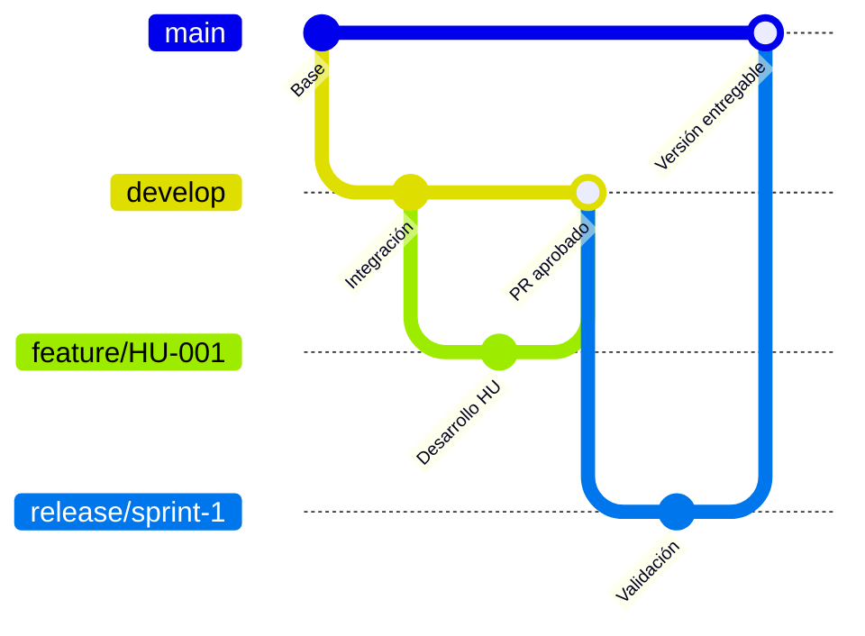

# Guía de GitFlow

| Campo | Información |
|---|---|
| Proyecto | Red Vital |
| Código | PROC-GF-001 |
| Versión | 1.0 |
| Estado | Borrador |
| Responsable | DevOps |
| Revisado por | Arquitectura y Scrum Master |
| Fecha de creación | AAAA-MM-DD |
| Próxima revisión | AAAA-MM-DD |

## 1. Objetivo

Definir la estrategia de ramas, commits, revisiones y entregas para los repositorios de Red Vital. Esta guía busca mantener la trazabilidad entre los elementos del backlog, el código, la documentación, las pruebas y los despliegues.

## 2. Alcance

Aplica a los repositorios de la organización `Arkue-Software`:

| Repositorio | Contenido |
|---|---|
| `identity`, `institutional`, `campaign`, `donation`, `notifications` | Un servicio por repositorio, con su contrato AsyncAPI y sus pruebas. |
| `frontend` | Aplicación web. |
| `tools` | Configuración del API Gateway (Apache APISIX). |
| `databases` | Roles y migraciones SQL de cada servicio. |
| `Despliegue_RedVital` | Composición por VM, Kafka, secretos, firewall y pruebas de sistema. |
| `docs` | Documentación en Markdown, ADRs, procesos, pruebas, plantillas, actas y entregables. |

Ningún integrante debe realizar cambios directos sobre las ramas protegidas.

## 3. Modelo de ramas

La rama de integración se llama `develop` en todos los repositorios de código. El repositorio `docs` todavía integra sobre `main`.

| Rama | Uso | Se integra en |
|---|---|---|
| `main` | Versión entregada. | No recibe cambios directos. |
| `develop` | Integración del Sprint. Es la rama que arma el despliegue de QA (`scripts/clonar-repos.sh`). | `release/*` |
| `feature/<tema>` | Historia o funcionalidad nueva. | `develop` |
| `fix/<tema>` | Corrección de un defecto. | `develop` |
| `chore/<tema>`, `ci/<tema>`, `docs/<tema>` | Mantenimiento, integración continua y documentación. | `develop` |
| `release/<sprint>` | Validación de QA previa a la entrega. | `main` |

## 4. Pull Requests

1. Todo cambio llega a `develop` por Pull Request, con al menos una revisión.
2. La integración continua debe pasar antes de fusionar: compilación y pruebas del servicio, y los escaneos de secretos y dependencias donde estén configurados.
3. Un cambio que toca varios repositorios se entrega como un Pull Request por repositorio, enlazados entre sí en la descripción, y se fusionan en el orden que evite romper `develop`.
4. QA valida sobre el ambiente desplegado desde `develop`. Con su visto bueno se abre el Pull Request de `release/<sprint>` hacia `main`.

## 5. Commits

Los mensajes siguen la forma `tipo: descripción`, en español y en presente, con los tipos `feat`, `fix`, `docs`, `ci`, `chore`, `test` y `refactor`. El cuerpo explica el motivo del cambio cuando no es evidente.
